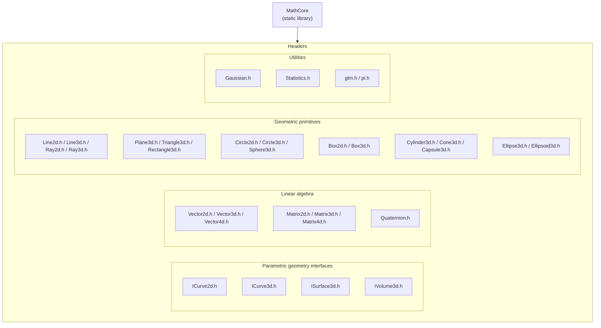

# Math Module — File Layout

Sources and public headers live in `Math/`, tests in `MathTest/`.
`CMakeLists.txt` builds this module standalone or from the CGLib root.

The module uses the `Phantom::Math` namespace. Its types are thin GLM aliases
defined as `float` / `double` templates. See
[`../docs/module-reference.md`](../docs/module-reference.md) for API details.

- Each geometric primitive implements its corresponding interface, such as
  `ICurve3d<T>`, and provides `float` and `double` aliases such as `Line3df`
  and `Line3dd`.
- Operations are free functions such as `getLength`, `getDistance`, and
  `areSame`, rather than member functions. Use `glm::dot`, `glm::cross`, and
  `glm::normalize` directly.

## Contracts

These are the agreed behaviours for boundaries, invalid input and precision.
Each is pinned by a `float` / `double` test in `MathTest`.

- **No exceptions.** Results that cannot be defined are reported with a
  `bool tryXxx(T& out)` function that returns `false` and leaves `out`
  unchanged. Failure means empty, zero-length, (nearly) parallel or non-finite
  input.
- **Normals.** `Ellipse3d::getNormal()` returns a unit normal, or the zero
  vector for a degenerate ellipse; use `tryGetNormal()` to tell the cases
  apart. `Triangle3d` and `Rectangle3d` also provide `tryGetNormal()`, but their
  `getNormal()` still yields NaN for a degenerate shape because Space's
  intersection code detects degenerate triangles with `isFinite(getNormal())`.
  "Nearly parallel" is relative: `|cross| <= 8 * epsilon * |a||b|`, independent
  of absolute scale (`SafeNormalize.h`).
- **Statistics.** `getAverage()` / `getVariance()` / `getStandardDeviation()`
  keep their original behaviour (NaN for an empty set). `tryGet*()` additionally
  fail on empty sets and non-finite values or results. Variance is the
  population variance (divides by N).
- **Containment.** `Box3d::contains` and `Sphere3d::contains` are strict:
  points on the surface are not contained. `tolerance` grows the shape on every
  side before the strict test. A zero-volume box contains nothing at tolerance 0.
- **Degenerate primitives.** A zero radial vector collapses `Cylinder3d` /
  `Cone3d` / `Ellipse3d` onto their axis or centre. `Capsule3d` with a
  zero-length or non-finite axis becomes a sphere around `bottom`. `Torus3d`
  with a zero-length or non-finite axis falls back to +Y. None of them produce
  NaN from a zero vector.
- **Comparison.** `areSame` uses the absolute Euclidean distance with a strict
  `<`; the tolerance is in world units.
- **Precision.** Every public class template is explicitly instantiated for
  `float` and `double`.

## Header self-containment

Every public header compiles on its own, without a precompiled header. The
`MathHeaderCheck` CMake object library compiles one generated translation unit
per header (`cmake --build <dir> --target MathHeaderCheck`).
